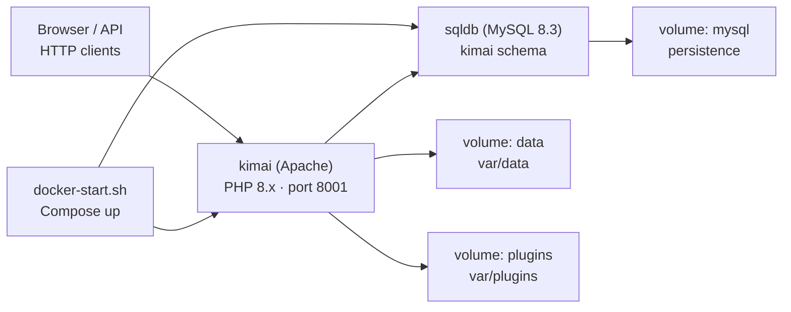
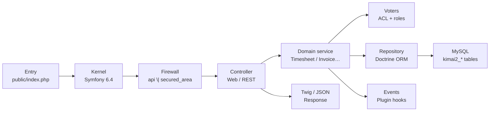
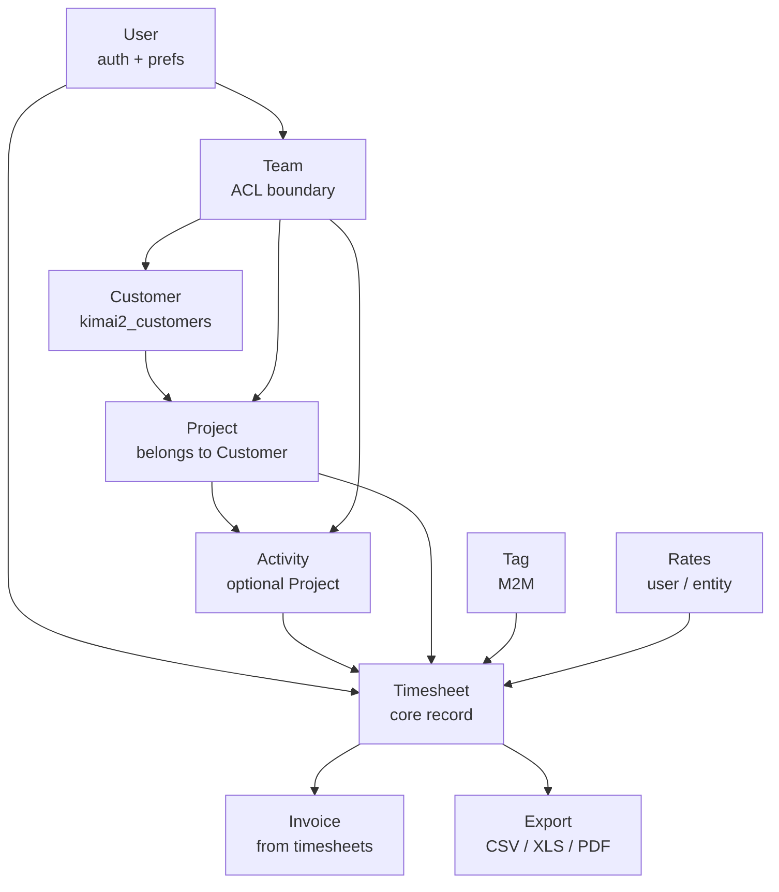
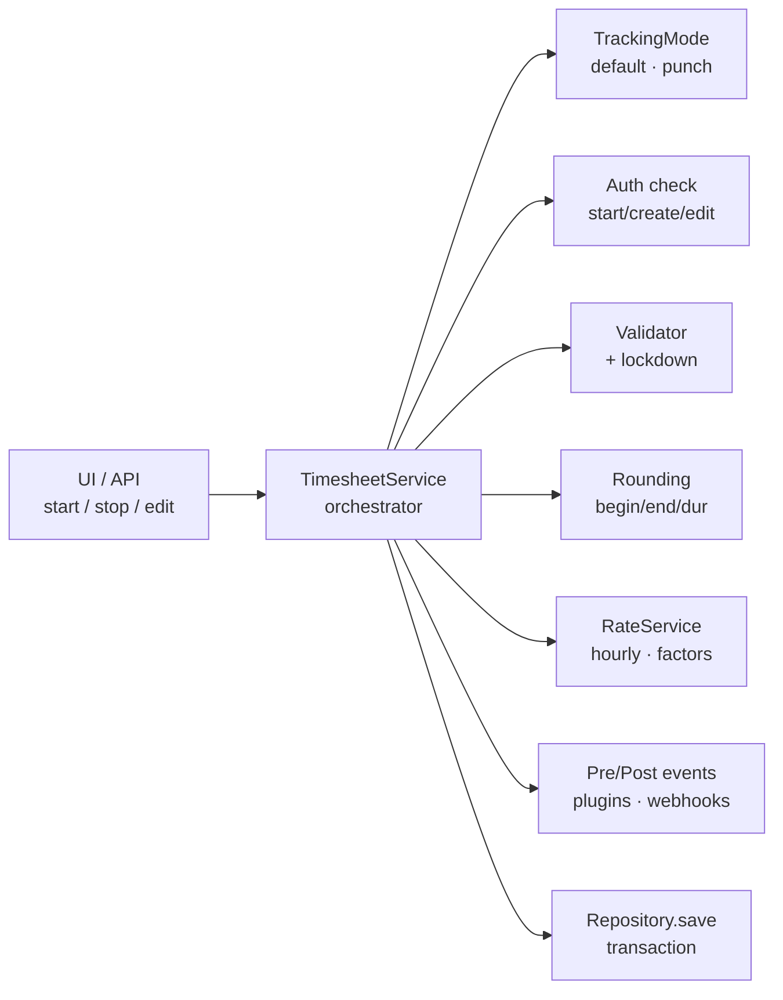

# Aariva Punch — System Analysis

> Kimai fork

Time-tracking platform built on Kimai (Symfony 6.4). Local stack is Docker Compose: Apache/PHP app + MySQL 8.3. Branding overrides live in `config/packages/aariva.yaml`.

| Framework | Runtime | Database | Domain model |
| --- | --- | --- | --- |
| Symfony 6.4 | PHP 8.2–8.5 | MySQL 8.3 | ~40 entities |

## Verdict

Classic layered Symfony monolith: HTTP entry → security firewalls → controllers → domain services → Doctrine repositories → MySQL. Cross-cutting behavior (menus, invoices, plugins, webhooks) hangs off a large event bus (~120 event classes).

Domain center of gravity is the Timesheet row: User + Project + Activity + optional Tags/Rates. Customers own projects; Teams gate visibility via ACL voters. Invoices and exports consume filtered timesheet sets and mark them exported.

---

## 1. Deployment topology

Source: `docker-compose.yml`, `docker-start.sh`, `Dockerfile` (target prod / BASE=apache)

### Surfaces

| Path | Purpose |
| --- | --- |
| `/{locale}/…` | Web UI (Twig + Tabler) |
| `/api/…` | JSON REST (FOSRest + JMS) |
| `/api/doc` | OpenAPI / Stoplight |
| `/auth/…` | 2FA, auth helpers |
| `localhost:8001` | Published Kimai port |

### Runtime env

| Key | Role |
| --- | --- |
| `DATABASE_URL` | MySQL DSN → sqldb |
| `APP_SECRET` | Symfony secret |
| `ADMINMAIL` / `ADMINPASS` | First-boot admin |
| `MAILER_URL` | Outbound mail (optional) |
| volumes data/plugins | Uploads + plugin code |

---

## 2. Request / system flow

Every authenticated call passes a firewall, then a controller that delegates to services. Voters enforce entity-level permissions; domain events fire around persistence.

### Web UI path

`src/Controller/*` · attribute routes under `/{_locale}`

Forms → TimesheetService / InvoiceService → Twig templates (Bootstrap/Tabler). Webpack Encore builds assets into `public/build/`.

### API path

`src/API/*` · prefix `/api`

Stateless firewall: AccessTokenHandler + TokenAuthenticator. JMS Serializer groups expand/collapse nested entities.

### Auth path

Form login · SAML · LDAP · API tokens · login links · 2FA

Chain user provider. Role hierarchy: USER → TEAMLEAD → ADMIN → SUPER_ADMIN. Login throttling: 5 / 5 min.

---

## 3. Domain data model

Hierarchical tracking graph with Teams as the ACL overlay. Core fact table is `kimai2_timesheet`.

### Entity map (persistence)

| Entity | Table | Key relations | Notes |
| --- | --- | --- | --- |
| User | `kimai2_users` | Teams, Preferences, AccessToken | Internal / LDAP / SAML auth |
| Customer | `kimai2_customers` | Projects, Teams, Rates, Meta | Budget + invoice template |
| Project | `kimai2_projects` | Customer*, Teams, Activities | Budget, comments, rates |
| Activity | `kimai2_activities` | Project?, Teams, Rates | Global or project-scoped |
| Timesheet | `kimai2_timesheet` | User*, Project*, Activity*, Tags | begin/end, duration, rate, billable |
| Team / TeamMember | `kimai2_teams` / `users_teams` | Users ↔ Customers/Projects/Activities | Visibility boundary |
| Invoice | `kimai2_invoices` | Customer, User, Meta | Rendered from timesheet items |
| WorkingTime | working time entity | User + date | Contracts / overtime modes |
| Configuration | `kimai2_configuration` | key/value | System settings overlay |
| Role / RolePermission | `kimai2_roles*` | permission grants | Customizable ACL matrix |

---

## 4. Timesheet data flow (write path)

Orchestrated by `App\Timesheet\TimesheetService`. Tracking modes: default, duration-fixed-begin, punch-in/out.

### Start / create

| Step | What happens |
| --- | --- |
| 1 | `createNewTimesheet(user)` + `TrackingMode.create` |
| 2 | MetaDefinitionEvent (custom fields) |
| 3 | Permission: start or create |
| 4 | Validate + fix timezone |
| 5 | CreatePre → repository.save → CreatePost |
| 6 | If running: stopActiveEntries (hard_limit) |

### Stop / settle

| Step | What happens |
| --- | --- |
| 1 | Set end = now (user TZ) |
| 2 | RoundingService adjusts begin/end/duration |
| 3 | RateService computes rate / internal rate |
| 4 | StopPre → save → StopPost |
| 5 | Billable mode resolved (auto/yes/no) |
| 6 | Downstream: invoice / export consumers |

---

## 5. Downstream value flows

### Invoicing

Query billable timesheets → `InvoiceModelFactory` → calculator → number generator → renderer (Twig/PDF/mPDF) → persist Invoice → mark entries exported.

Service: `App\Invoice\InvoiceService`. SSRF-safe HTTP client wraps remote logo fetches for PDF.

### Export & reporting

`ServiceExport` + column templates; spreadsheet / CSV / PDF renderers. Reporting controllers aggregate repository statistic queries (indexed by user, date_tz, project).

WorkingTime module overlays contracts / overtime modes on user calendars.

---

## 6. Security & extension model

### Authorization layers

| Layer | Mechanism |
| --- | --- |
| Firewall | api (token) vs secured_area (session) |
| Roles | USER / TEAMLEAD / ADMIN / SUPER_ADMIN |
| Permissions | kimai.permissions sets in kimai.yaml |
| Voters | Timesheet, Project, Customer, Team, … |
| Teams | M2M visibility on customers/projects/activities |
| 2FA | TOTP via scheb_2fa |

### Extensibility

| Hook | Location |
| --- | --- |
| Plugins | var/plugins (volume) · PluginManager |
| Events | src/Event/* (~120) + subscribers |
| Webhooks | AsWebhook attribute |
| Meta fields | Customer/Project/Activity/Timesheet meta |
| Tracking modes | Timesheet/TrackingMode/* |
| Invoice renderers | Invoice/Renderer/* |

---

## Architecture notes for this fork

### What is Aariva-specific

Branding only so far: logo + company name in `aariva.yaml`, Docker helper scripts, compose stack on port 8001.

### Strengths

Clear service boundaries around timesheets/invoices, rich ACL, event-driven plugins, dual Web+API surface, mature schema indexes for stats.

### Complexity hotspots

Permission matrix + team ACL voters; Timesheet validation / lockdown / rate stacking; invoice document pipeline; multi-auth providers.

---

Analysis based on repository structure under punch-aariva · Kimai core + local Docker packaging · 2026-11-28
